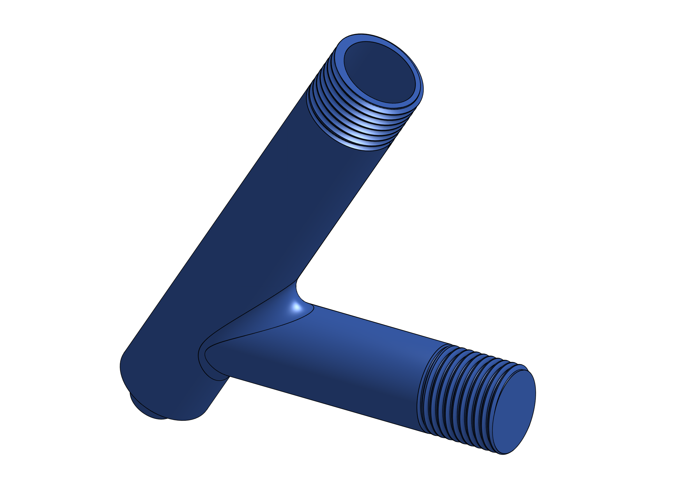
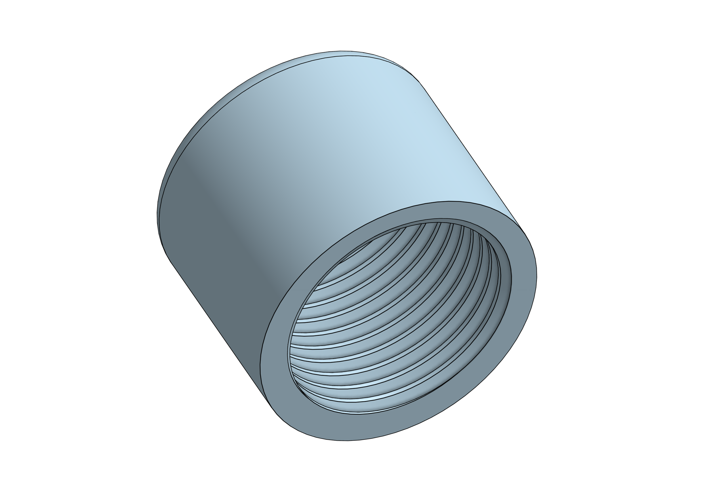
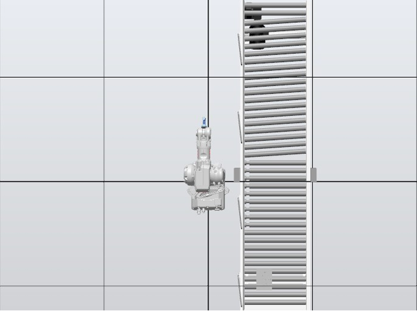
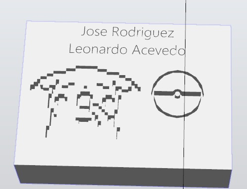
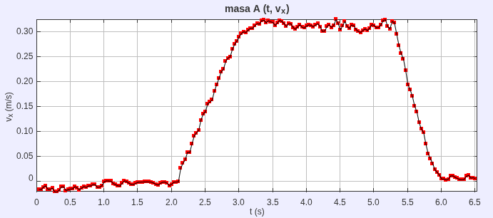
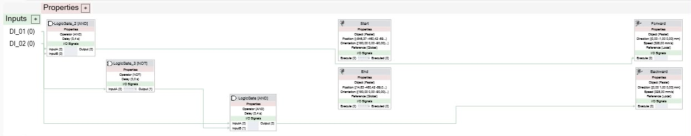

# Laboratorio No. 01 - Robótica Industrial ABB IRB140 y RobotStudio
## Introducción
Este laboratorio tiene como propósito el desarrollo de un programa para el robot ABB IRB 140 a través del software Robot Studio, con el fin de que cuando el usuario lo indique, mediante entradas digitales administradas en el teach pendant, desarrolle una de las siguientes 3 rutinas:

1. La decoración de un pastel, cuando el usuario lo indique, en donde el programa también se hace cargo de llevar el pastel al workspace del robot mediante el uso de una banda transportadora y posterior a la decoración del pastel el retiro del pastel del workspace del robot.
2. Posicionar el robot de forma tal que el operario pueda hacer el cambio de la herramienta y el mantenimiento del robot de manera cómoda.
3. Hacer una rutina para que el robot farmee aura.

## Diseño de la herramienta

El diseño de la herramienta se hizo de manera secuencial desde el flanche. En ese orden lo primero en diseñarse es el acople a este, mediante tornillos M4, ya que es la rosca que trae el flanche por defecto, a su vez este acople se une al cuerpo de la herramienta mediante una rosca M23 de 2mm de paso tal y como se especifica en el plano del [acople al flanche](./Herramienta/Planos/Acople_flanche.pdf). 

<p align="center">

<p>

Lo segundo es diseñar el cuerpo de la herramienta, esta se diseña para permitir una escritura cómoda, imitando el ángulo en el que se suele agarrar el marcador de alrededor de 60° respecto a la horizontal, con la rosca respectiva para unirse al acople del flanche y que la hace fácil de intercambiar, además de otra rosca que permite poner en su interior el marcador, para más detalles acceda a [especificaciones geométricas](./Herramienta/Planos/Cuerpo_herramienta.pdf).

<p align="center">

<p>

Lo tercero es diseñar la tapa para asegurar el marcador, con un acople roscado al cuerpo, en ella se pone un resorte cuya rigidez se deja a elección del fabricante, pero debe de tener en cuenta que la función del resorte es amortiguar impactos en la punta del marcador, por lo que se recomienda no excederse con la rigidez de este. Los detalles geométricos de la tapa se encuentran [aquí](./Herramienta/Planos/Tapa.pdf)

<p align="center">

<p>

Por último se ensamblan todos los componentes incluido un modelo del marcador, para poder exportar el conjunto como un archivo [.sat](./Herramienta/Herramienta.sat), necesario para crear la herramienta en robot studio.

<p align="center">

<p>

**Nota:** Los archivos de impresión de la herramienta se encuentran [aquí](./Herramienta/Archivos_impresión/)

## Vista de planta

En el proceso del diseño de las trayectorias es fundamental tener en cuenta el entorno del robot, con el fin de evitar choques con objetos no contemplados en el software. Por lo que tras una calibración del workspace, se ubica la posición de la banda y el pastel relativos al robot como puede verse a continuación:

<p align="center">

<p>

## Código del RAPID

Una vez se establece correctamente el entorno del robot (aunque el workspace necesita iteración más adelante debido a la incertidumbre introducida por la banda) se pueden establecer todos los targets necesarios para crear las trayectorias, para facilitar esta tarea se usa el generador de texto de Inventor, junto con el contorno del dibujo que se quiere plasmar en el pastel para generar una extrusión en el pastel que ayuda a elegir los puntos con mayor precisión.

<p align="center">

<p>

Una vez marcados todos los **targets** necesarios para crear la trayectoria (incluyendo los de las rutinas de **Farmear aura** y **Posición de mantenimiento**, así como el punto de aproximación para devolver la herramienta al cambiar de un trazo a otro), se pueden generar los *paths* necesarios en el orden indicado para obtener la trayectoria deseada. 

Estos *paths* cuentan con 3 funciones dependiendo del trazo o movimiento requerido:

### MoveJ
Se utiliza para desplazamientos desde el punto actual hasta el destino especificado. En este tipo de movimiento no importa la trayectoria intermedia; el robot calculará la ruta óptima para llegar al punto. 

Su sintaxis es:
```rapid
MoveJ PuntoDestino, Velocidad, Zona, Herramienta [\WObj];
```

Esta función requiere los siguientes argumentos:
* **PuntoDestino:** El *target* de llegada.
* **Velocidad:** Rapidez a la cual va a desplazarse (ej. `v500`).
* **Zona de aproximación:** La tolerancia con la cual el robot determina que ya ha llegado al punto (ej. `z10` o `fine`).
* **Herramienta:** Especifica el TCP actual (Tool Center Point).
* **\WObj (Opcional):** El sistema de referencia (Work Object) respecto al cual se calcula el *target*.

### MoveL
Realiza un desplazamiento en línea recta perfecta hacia el *target* destino. A veces puede llegar a confundirse con un `MoveJ`, ya que en muchos casos el desplazamiento articular más óptimo también se asemeja a una línea recta, pero `MoveL` garantiza la linealidad de la trayectoria. 

Su sintaxis es:
```rapid
MoveL PuntoDestino, Velocidad, Zona, Herramienta [\WObj];
```

Como se puede observar, comparte exactamente los mismos argumentos que `MoveJ`.

### MoveC
Esta función genera un desplazamiento a lo largo de una curva circular desde el punto actual hasta el destino. Para poder trazar la trayectoria geométrica, necesita un argumento extra llamado **PuntoCentral** (un punto intermedio en el espacio que el controlador utiliza para calcular el radio y la curvatura exacta). 

Su sintaxis es:
```rapid
MoveC PuntoCentral, PuntoDestino, Velocidad, Zona, Herramienta [\WObj];
```
El resto de sus argumentos funcionan de la misma manera que en las instrucciones anteriores.

---

Ahora el conjunto de trayectorias hechas con las funciones descritas anteriormente se encapsulan en cada rutina respectiva mediante `PROC` que permite encapsular rutinas enteras bajo un nombre específico y luego se pueden llamar en el main.

Por último se usan funciones comunes en los lenguajes de programación para revisar si se cumple una condición (`IF`), crear un bucle mientras se cumpla una condición (`WHILE`),poner una entrada en 0 (`RESET`) o en 1 (`RESET`) y para esperar un determinado tiempo en segundos (`WaitTime`)

El código completo se encuentra [aquí](./Lab1_Codigo_robot_studio/Controller%20Data/IRB140_6_81/RAPID/TASK1/PROGMOD/Module1.mod)

### Entradas y salidas digitales

#### Entradas digitales
El código cuenta con 3 entradas digitales, cada una habilita una rutina, pero deben de esperar a que se acabe de ejecutar la anterior para poder ser leídas, en donde `DI_01` activa la rutina uno como se ve en este fragmento del código:
```rapidip
            IF DI_01=1 THEN
                
                rutina de decoración del pastel...
```
La segunda entrada digital es `DI_02` esta se encarga de activar la rutina de mantenimiento y se necesita que esta se apague para que se acabe la rutina como se ve a continuación:
```rapid
            ELSEIF DI_02=1 THEN
                SET DO_02;
                Mantenimiento_p;
                WHILE DI_02 = 1 DO        
                ENDWHILE
                IF DI_01 = 1 OR DI_03=1 THEN
                    Real_Home;
                    RESET DO_02;
                ENDIF
```

Y por último `DI_03`, que es la entrada que habilita la rutina de Farmear aura, como se muestra a continuación:

```rapid
        ELSEIF DI_03=1 THEN
                SET DO_03;
                Real_Home;
                Aura;
                Real_Home;
                RESET DO_03;
```
#### Salidas digitales

Se cuentan con 5 salidas digitales en total: 3 hacia una HMI (`DO_01`,`DO_02` y `DO_03`) que encienden o apagan indicadores para que el operador sepa cuándo se está o no ejecutando una de las 3 rutinas respectivamente. Las otras 2 salidas se usan para utilizar la banda, en donde `BWD_Conveyor` habilita el motor de la cinta y `FWD_Conveyor` indica el sentido de giro del motor, por lo que se juega con estas dos entradas para llevar la caja hacia el robot. 

#### Simulación de la banda 

Dado que la banda posee una dinámica a considerar, la cual es la velocidad de esta. Para saber cuánto tiempo hay que dejarla encendida con el fin de que el pastel llegue lo más cerca posible al workspace establecido se mide experimentalmente su perfil de velocidad a partir de la grabación desde la parte superior de esta de un objeto en movimiento y mediante un tracker se obtiene la siguiente gráfica:

<p align="center">

<p>

Con esto se establece el tiempo necesario para llegar a la posición indicada, ya que la velocidad de crucero es de 0.328 m/s aproximadamente y las rampas tienen una pendiente de alrededor de 0.27 m/s².

Para la simulación se crea un smart component que imita el comportamiento de la banda y su lógica tal y como se muestra:

<p align="center">

<p>

Estos cálculos permitieron calcular los delays que se pueden ver en secciones como estas del código:
```rapid
        IF DI_01=1 THEN
                
            SET BWD_Conveyor;
            SET FWD_Conveyor;
            WaitTime(2.591);
            RESET FWD_Conveyor;           
            RESET BWD_Conveyor;
```

# Funcionamiento 

Una vez simulado el código e iterado la posición del workspace, se sube el código al controlador del robot mediante conexión WiFi, y se depura el código paso a paso hasta estar seguros que las rutinas sirven por completo, Una vez rectificado se evidencia el funcionamiento del código completo:

<p align="center">
  <a href="https://youtu.be/3qK06tKSGvg" target="_blank" rel="noopener noreferrer">
    
  </a>
</p>


