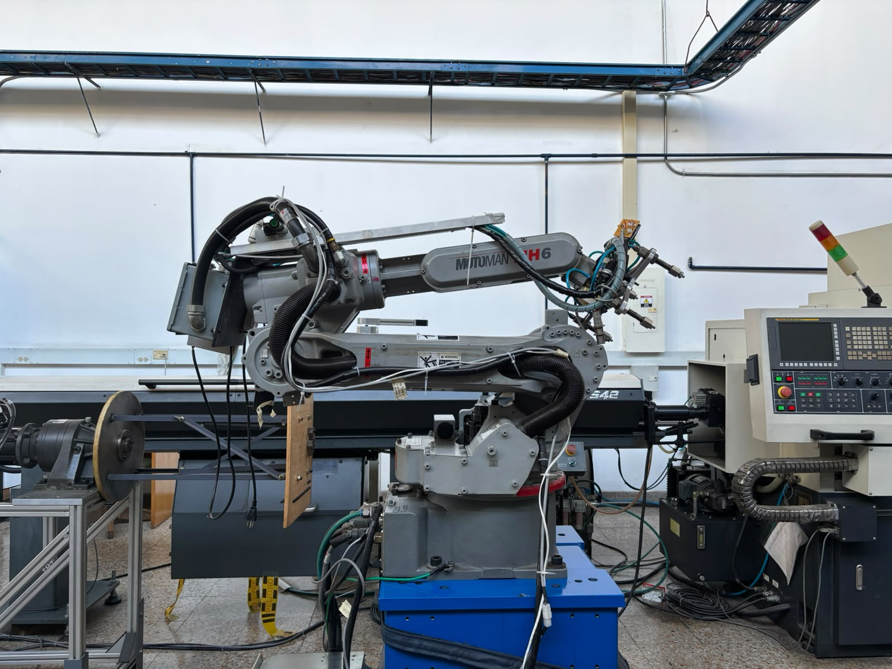
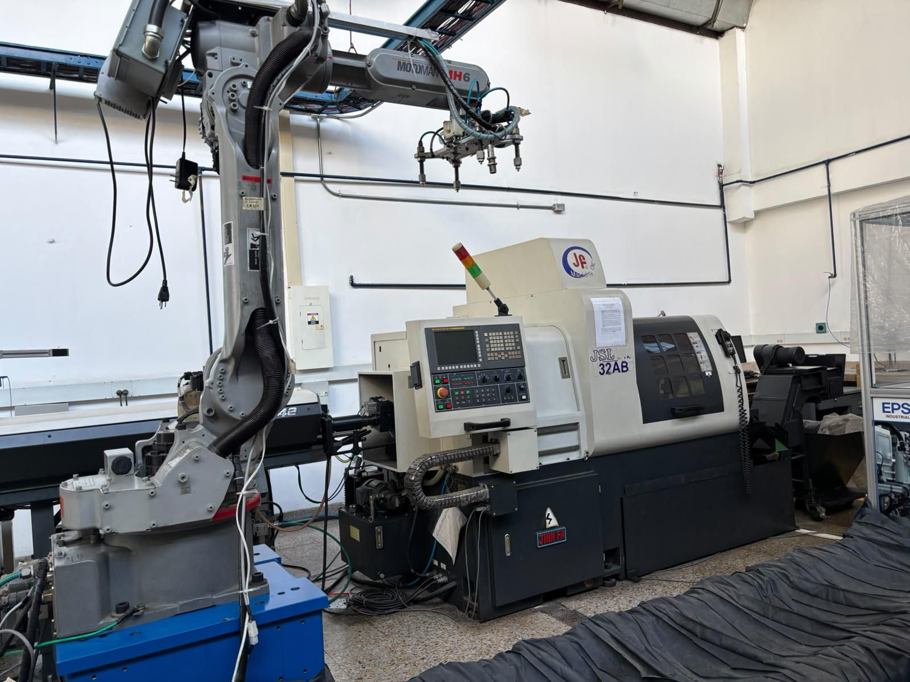
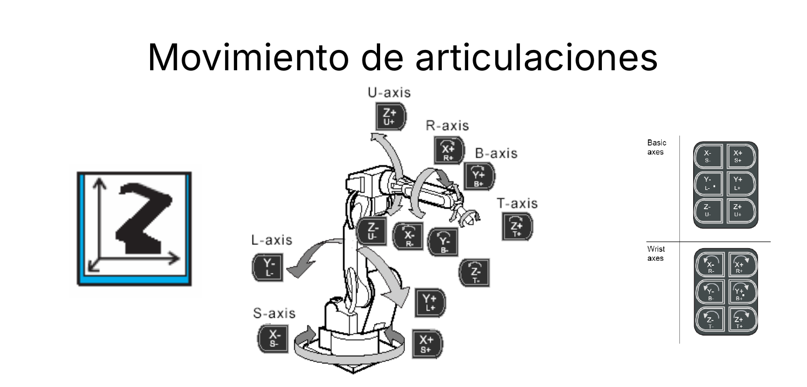
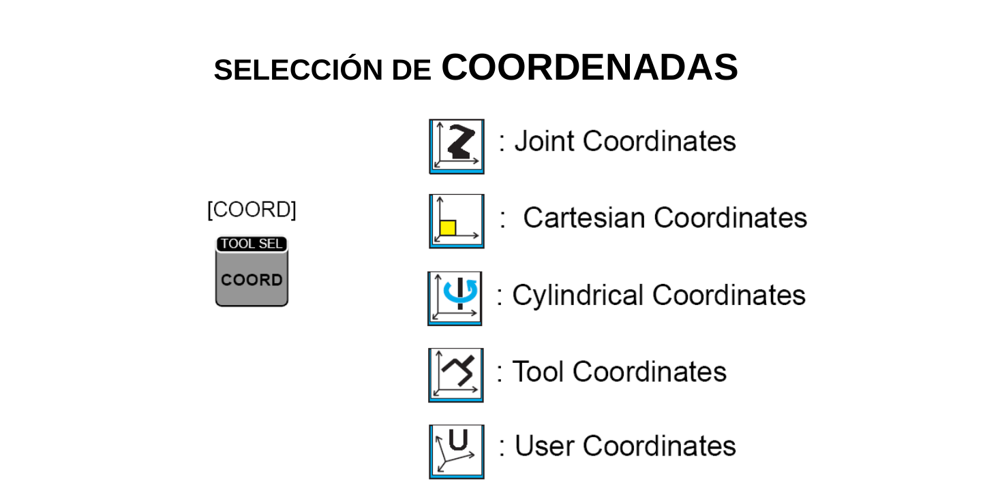
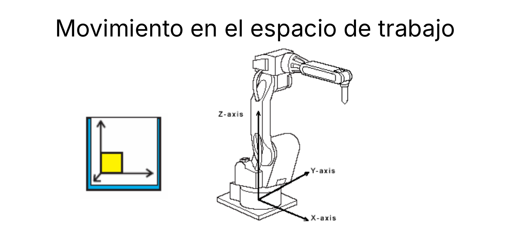
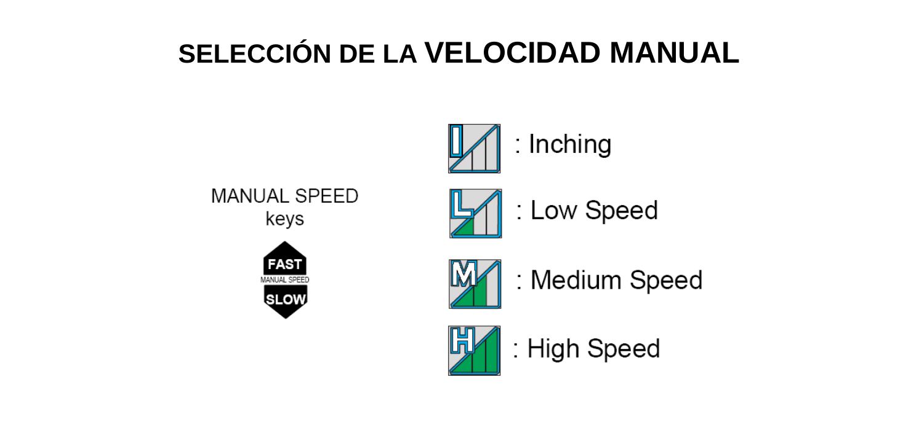
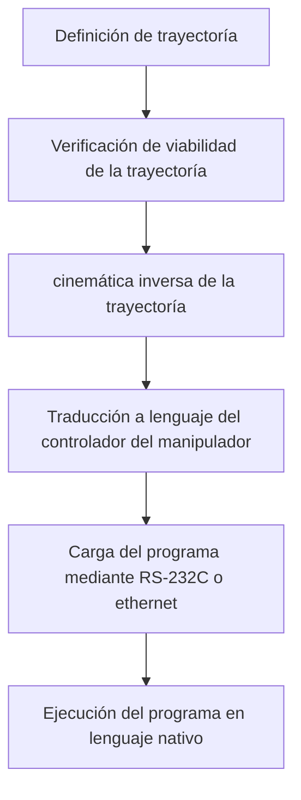
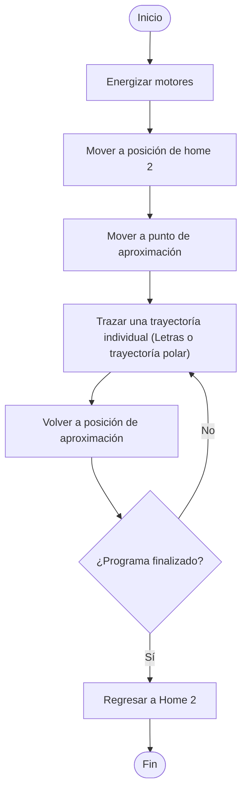
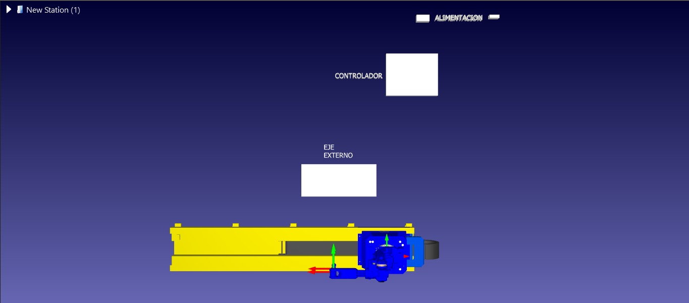
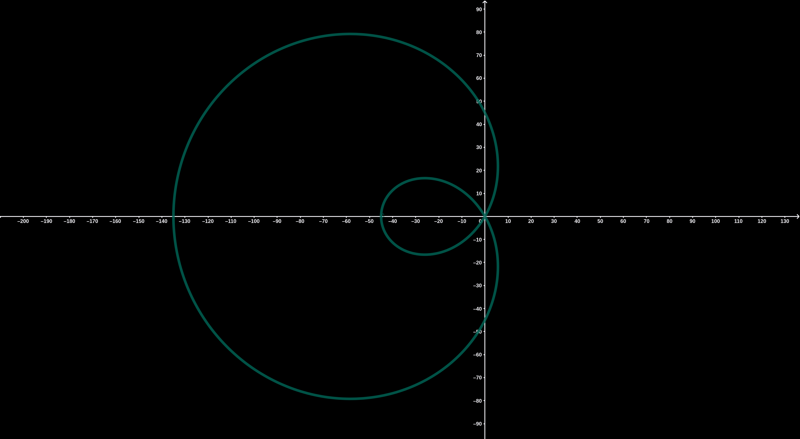

<div align="center">

# 🤖 Laboratorio No. 02 — Robótica Industrial
## Análisis y Operación del Manipulador Motoman MH6

**Robótica 2026-I · Universidad Nacional de Colombia**


</div>

---

## 👥 Integrantes

| Nombre | Correo institucional | GitHub |
|---|---|---|
| Jose Manuel Rodríguez Sandoval | josrodriguezsa@unal.edu.co | [@Chemarod1406](https://github.com/Chemarod1406) |
| Leonardo Acevedo Monroy | leacevedo@unal.edu.co | [@LeonardoA29](https://github.com/LeonardoA29)|

> **Fecha de entrega:** `20/11/2026`

---

## 📑 Tabla de contenido

1. [Introducción](#-introducción)
2. [Cuadro comparativo: Motoman MH6 vs ABB IRB140](#1--cuadro-comparativo-motoman-mh6-vs-abb-irb140)
3. [Configuraciones iniciales: Home 1 y Home 2](#2--configuraciones-iniciales-home-1-y-home-2)
4. [Movimientos manuales](#3--movimientos-manuales)
5. [Niveles de velocidad](#4--niveles-de-velocidad)
6. [RoboDK: funcionalidades y comunicación](#5--robodk-funcionalidades-y-comunicación)
7. [RoboDK vs RobotStudio](#6--robodk-vs-robotstudio)
8. [Diagrama de flujo](#7--diagrama-de-flujo-de-acciones-del-robot)
9. [Plano de planta](#8--plano-de-planta)
10. [Trayectoria polar](#9--trayectoria-polar)
11. [Video](#10--video)
12. [Referencias](#-referencias)

---

## 📖 Introducción

Este laboratorio tiene como objetivo ña familiarizacióm con el uso de RoboDK con el objetivo de programar trayectorias, en este caso mediante coordenadas polares, del robot Yaskawa Motoman MH6 y en complemento al [Laboratorio N°1](https://github.com/labsir-un/Robotica_2026-II_Grupo_1A_Acevedo_Rodriguez/tree/main/Laboratorio%20No.%2001%20-%20Rob%C3%B3tica%20Industrial%20ABB%20IRB140%20y%20RobotStudio) poder comparar tanto a los manipuladores (Motoman MH6 e IRB140), como los software utilizados para pogramar en ellos (RobotDK y RobotStudio).
 
**Resultados de aprendizaje cubiertos:**

- Comparación técnica Motoman MH6 vs IRB140
- Configuraciones home1 y home2
- Movimiento manual (articulaciones, cartesiano, traslación y rotación)
- Control de niveles de velocidad
- Aplicaciones de RoboDK y comunicación con el manipulador
- Comparación RobotStudio vs RoboDK
- Trayectoria polar simulada y física

---

## 1. 📊 Cuadro comparativo: Motoman MH6 vs ABB IRB140

| Característica | Yaskawa Motoman MH6 | ABB IRB140 |
|---|---|---|
| Fabricante | Yaskawa | ABB |
| Grados de libertad | 6 | 6 |
| Carga máxima (payload) | 6 Kg | 6 Kg |
| Alcance máximo | 1.422 m | 0.8 m |
| Repetibilidad | 0.08 mm | 0.03 mm |
| Peso del robot | 130 kg | 98 Kg |
||**Velocidad máx. por eje** ||
|Eje 1| 220°/s|200°/s|
|Eje 2| 200°/s|200°/s|
|Eje 3| 220°/s|260°/s|
|Eje 4| 410°/s|360°/s|
|Eje 5| 410°/s|360°/s|
|Eje 6| 610°/s|450°/s|
| |**Rango de movimiento por eje**||
|Eje 1|+170° a -170°|+180° a -180°|
|Eje 2|+155° a -90°|+110° a -90°|
|Eje 3|+250° a -175°|+50° a -230°|
|Eje 4|+180° a -180°|+200° a -200°|
|Eje 5|+225° a -45°|+115° a -115°|
|Eje 6|+360° a -360°|+400° a -400°|
|-|-|-|
| Controlador | DX100 | IRC5 |
| Lenguaje de programación | INFORM III | RAPID |
| Montaje |Permite montaje en piso, pared y techo M18| Permite montaje en piso, pared o suspendido con anclaje mediante pernos M12|
| Protección (IP) | IP67 | IP67 |
| Aplicaciones típicas | Soldadura, empaque y ensamblaje| Remosión de material, empauqe,soldadura y ensamblaje|
---

El cuadro anterior es unicamente de los manipuladores, sin embargo el Motoman incorpora un eje externo y un riel sobre el que va montado que le otorgan 2 GDL extras.

## 2. 🏠 Configuraciones iniciales: Home 1 y Home 2

### Posición de cada articulación

| Articulación | Home 1 (Pulsos) | Home 2 (Pulsos) |
|---|:---:|:---:|
| S (J1) | 0 | 0 |
| L (J2) | -115290 | 2037 |
| U (J3) | -111622 | 2359 |
| R (J4) | 1 | 0 |
| B (J5) | 42647 | -121 |
| T (J6) | 1392 | 1392 |

### Descripción

| | Home 1 | Home 2 |
|---|---|---|
| Descripción de la postura | La postura que ocupa el meno volumen posible| Postura de operación|
| Uso típico | Para el transporte del robot| Es la pose que se usa para dar inicio a la mayor parte  de rutinas ofrece una aproximación segura a la superficie de trabajo|

| Home 1 | Home 2 |
|:---:|:---:|
|  |  |

### ¿Cuál posición es mejor?

> No hay una posición mejor que otra, en definitiva cada una tiene un uso específico, tanto Home 1 facilitando el transporte del manipulador como Home 2 como pose inicial y segura para el inicio de cualquier rutina.
---

## 3. 🕹️ Movimientos manuales

### 3.1 Procedimiento general

1. Girar el **selector de modo `[MODE]`** a **TEACH** (las opciones son REMOTE, PLAY y TEACH). El movimiento manual solo se permite en este modo.
2. Presionar **`[SERVO ON READY]`** para habilitar los servomotores.
3. Mantener presionado el **Enable Switch** (interruptor de hombre muerto de 3 posiciones, en la parte posterior del pendant) en su posición intermedia. Si se suelta o se aprieta a fondo, los servos se desactivan.
4. Elegir el sistema de coordenadas (tecla `[COORD]`) y el nivel de velocidad (teclas `MANUAL SPEED`), y mover con las teclas de ejes.

> El **botón de paro de emergencia** (Emergency Stop) siempre está disponible en el pendant.

### 3.3 Teclas por movimiento

**Modo articulaciones**

| Eje | Articulación | Tecla (−) | Tecla (+) |
|-----|--------------|-----------|-----------|
| S | Giro de la base | `X-/S-` | `X+/S+` |
| L | Brazo inferior | `Y-/L-` | `Y+/L+` |
| U | Brazo superior | `Z-/U-` | `Z+/U+` |
| R | Rotación del antebrazo | `X-/R-` | `X+/R+` |
| B | Flexión de la muñeca | `Y-/B-` | `Y+/B+` |
| T | Giro de la brida (flange) | `Z-/T-` | `Z+/T+` |

En el teclado, los ejes **S, L, U** son el bloque *Basic axes* y los ejes **R, B, T** el bloque *Wrist axes*.


### 3.4 Cambio a modo cartesiano

Se presiona **`[COORD]`** repetidamente; cada pulsación cambia al siguiente sistema, y el ícono del área de estado indica el activo:

**Joint → Cartesian (Base) → Cylindrical → Tool → User**



Al elegir **Cartesian** (ícono del cuadrado amarillo sobre los ejes), el movimiento se expresa respecto a los ejes X, Y, Z fijos de la base del robot. Las mismas teclas ahora significan:



**Traslación del TCP (punta de la herramienta) en X, Y, Z**

| Movimiento | Tecla |
|------------|-------|
| X− / X+ | `X-/S-` / `X+/S+` |
| Y− / Y+ | `Y-/L-` / `Y+/L+` |
| Z− / Z+ | `Z-/U-` / `Z+/U+` |

**Rotación de la herramienta alrededor de los ejes X, Y, Z** (bloque *Wrist axes*, teclas con flechas curvas)

| Movimiento | Tecla |
|------------|-------|
| Giro alrededor de X (−/+) | `X-/R-` / `X+/R+` |
| Giro alrededor de Y (−/+) | `Y-/B-` / `Y+/B+` |
| Giro alrededor de Z (−/+) | `Z-/T-` / `Z+/T+` |

Otros sistemas disponibles con `[COORD]`: **Cylindrical** (cilíndrico), **Tool** (ejes X, Y, Z sobre la herramienta; sirve para avanzar o retroceder en la dirección en que apunta la herramienta) y **User** (sistema definido por el usuario).

📷 _Inserten fotos del teach pendant con las teclas señaladas:_


---

## 4. ⚡ Niveles de velocidad

|| Ícono en pantalla | Nivel | Descripción |
|:-:|-------|-------------|
| **I** | **Inching** | Movimiento incremental: cada pulsación de una tecla de eje produce un desplazamiento muy pequeño. Ideal para posicionamiento fino. |
| **L** | **Low Speed** | Velocidad baja |
| **M** | **Medium Speed** | Velocidad media |
| **H** | **High Speed** | Velocidad alta |

### Cómo se cambia entre niveles

Con las teclas **`MANUAL SPEED`**: **`FAST`** (arriba) y **`SLOW`** (abajo). Cada pulsación sube o baja un nivel en la secuencia:

**Inching ⇄ Low ⇄ Medium ⇄ High**

(`FAST` para aumentar la velocidad, `SLOW` para disminuirla.)



### Cómo se identifica el nivel en pantalla

En el **área de estado** (barra de íconos en la parte superior de la pantalla del pendant) hay un ícono para la **velocidad manual (Manual speed)**. Ese ícono muestra la letra del nivel activo (**I, L, M o H**) con barras que indican la magnitud. Junto a él aparecen los íconos del eje de operación del grupo y del sistema de coordenadas seleccionado (Joint, Cartesian, etc.).

---
*Imágenes: tomadas de la presentación del curso. Fuente: presentación "Programación y operación básica" del DX100 / MH6, Universidad Nacional de Colombia.*

---

## 5. 🧩 RoboDK: funcionalidades y comunicación

### 5.1 Funcionalidades principales

- Simulación y programación offline (OLP)
- Bibliotecas extensas de manipuladores de varias marcas comerciales
- Destección de colisiones, límites y singularidades
- Simulación de programas con varios manipuladores involucrados
- Traducción a lenguajes de programación propios de cada manipulador
- Integracioón CAD/CAM para el modelamiento de sólidos
- API y compatibilidad con lenguajes de alto nivel para el desarrollo de rutinas de forma más sencilla

### 5.2 ¿Qué hace RoboDK para mover el manipulador?

Una vez el usuario establece la trayectoria que debe de sguir el robot mediante la manipulación de paths y tagets, RoboDK realiza los cálculos cineáticos inversos necesarios para generar una lista de configuraciones que debe de seguir el robot en determinado orden para poder ejecutar la rutina, leugo de eso, se hace una traducción de la rutina a el lenguaje propio de cada controlador de cada robot, para luego cargar y ejecutar el progrma en el controlador.



### 5.3 ¿Cómo se comunica RoboDK con el manipulador?

| Aspecto | Detalle |
|---|---|
| Tipo de conexión | Ethernet / RS-232C |
| Driver | MotoCom SDK |


---

## 6. ⚖️ RoboDK vs RobotStudio

| Criterio | RoboDK | RobotStudio |
|---|---|---|
| Fabricante | RoboDK Inc | ABB |
| Marcas de robot soportadas | 80 Marcas | Únicamente ABB|
| Lenguaje / post-procesadores | 100 Postprocesadores | RAPID |
| Simulación | Herramientas de simulación básicas-intermedias | Simulación avanzada |
| API / scripting | Compatibilidad con múltiples lenguajes de alto nivel como MATLAB | Baja, de forma nativa |
| Licencia / costo | 145USD/año Licencia educativa | Gratuito para instituciones calificadas |
| Curva de aprendizaje | Aprendizaje rápida debido a el uso de lenguajes muy conocidos como python | Más lenta debido a la gran variedad de opciones que ofrece la interfaz|
|Aplicaciones| Desarrollo rápido de rutinas apoyado en lenguajes de programación que facilitan la creación de trayectorias complejas| Desarrollo profesional con simulacón de físicas realistas y que permiten una alta depuración del programa fuera de línea antes de correrlo en el manipulador.|

## 7. 🔀 Diagrama de flujo de acciones del robot



---

## 8. 🗺️ Plano de planta

[Plano de planta detallado](Img/Plano_de_planta.pdf)




---

## 9. 🌀 Trayectoria polar

### 9.1 Fundamento teórico

Un punto en coordenadas polares se define por `(r, θ)`:

```
a = 45
b = 90

r = a - b cos(θ)
x = r · cos(θ)
y = r · sin(θ)
```

Este corresponde a un coroide, que se puede ver a continuación 




### 9.2 Parámetros

| Parámetro | Valor |
|---|---|
| Curva | Coroide |
| Ecuación | r = a - b cos(θ) |
| Rango de θ | 0 - 2π|
| Número de puntos | 50 |
| Velocidad | 300 |

### 9.3 Implementación en RoboDK

```python

coroide = []
for i in range(num_points + 1):
    theta = 2 * math.pi * i / num_points
    r = a - b * math.cos(theta)
    coroide.append((r * math.cos(theta), r * math.sin(theta)))

path_jose = TextPath((0, 0), "Jose", size=75)
path_leonardo = TextPath((0, -50), "Leonardo", size=75)
text_path = Path.make_compound_path(path_jose, path_leonardo)

```

📁 **Código completo:** [`Coroide.py`](Coroide.py)


## 10. 🎬 Videos


| Video | Enlace |
|---|---|
| Video laboratorio 2 | [▶️ Ver video](https://youtu.be/k3YGh6LweOM) |

---


## 📚 Referencias

1. Yaskawa Motoman. (s. f.). _Motoman MH6R robot — adatlap_ [Ficha técnica, PDF]. Archivo local: `1431-motoman-mh6r-robot-adatlap.pdf`.
2. ABB Robotics. (s. f.). _Product specification - IRB 140_ [Ficha técnica, PDF].
3. RoboDK. (s. f.). _Documentación oficial de RoboDK._ https://robodk.com/doc/
4. Monografías.com. (s. f.). _Coordenadas polares._ https://www.monografias.com/trabajos33/coordenadas-polares/coordenadas-polares
---


